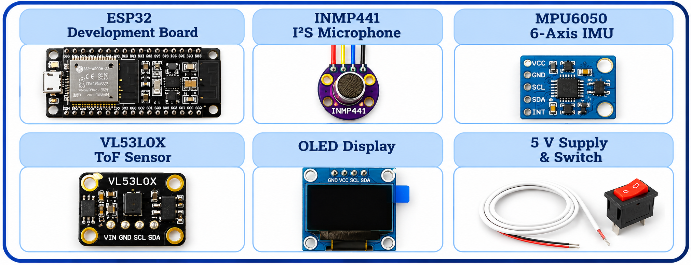
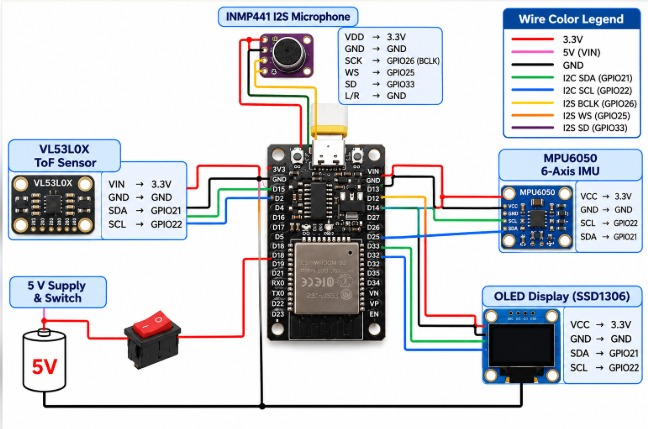
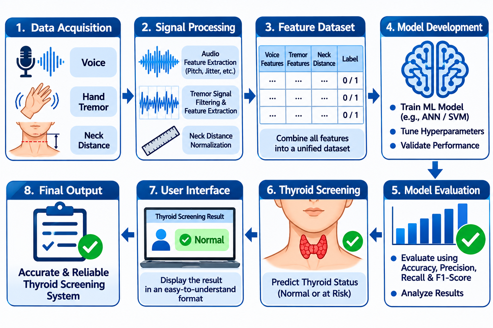
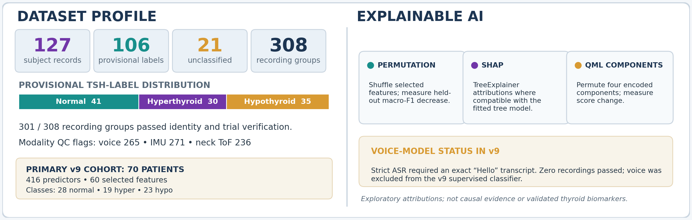
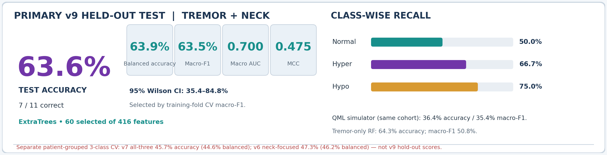

# Low-Cost and Non-invasive Thyroid Screening Platform 🩺

[](https://streamlit.io/)
[](https://www.python.org/downloads/)
[](https://opensource.org/licenses/MIT)
[](https://just.edu.bd/)

**A Multimodal Point-of-Care Biosignal Platform for Non-invasive Thyroid Screening**  
Developed at the **Department of Biomedical Engineering (BME), Jashore University of Science and Technology (JUST), Bangladesh**.

---

## 👥 Authors & Academic Supervisors

- **Lead Researchers**:
  - **Sakhawat Hosen Sifat** (Roll: 221901)
  - **Jannatun Khatun** (Roll: 221913)
- **Academic Supervisor**: **Dr. Hassan Mohammad Al-Emran**
- **Co-supervisor**: **Md. Faisal Mina**
- **Institution**: Department of Biomedical Engineering, Jashore University of Science and Technology, Jashore-7408, Bangladesh.

---

## 📌 Project Overview & Clinical Motivation

Thyroid disorders (hypothyroidism and hyperthyroidism) affect hundreds of millions globally. Standard clinical evaluation relies exclusively on invasive laboratory venipuncture assays measuring **Serum Thyroid-Stimulating Hormone (TSH)** and **Free Thyroxine (FT4)**. In low-resource, rural, and decentralized healthcare settings (such as upazila health complexes in Bangladesh), access to automated clinical biochemistry analyzers and cold-chain sample preservation is severely limited.

This project introduces a **low-cost, non-invasive point-of-care screening prototype** powered by an **ESP32 microcontroller**:
1. **6-Axis Hand Tremor Inertial Sensing (MPU6050)**: Captures tri-axial acceleration and angular velocity at 100 Hz to isolate fine postural thyrotoxic tremor (8–12 Hz band).
2. **Optical Time-of-Flight (ToF) Surface Distance (VL53L0X)**: Acquires 10 consecutive reads of anterior-neck surface distance. *(Note: Measures external surface proximity only; does not replace ultrasound or measure internal gland volume)*.
3. **Acoustic Voice Sampling (INMP441 I2S)**: 16 kHz audio recording for phonation stability assessment.
4. **Machine Learning Classifier**: A high-dimensional 416-descriptor bio-signal feature extraction pipeline coupled with tree ensemble and neural network classifiers.

---

## 📐 Hardware Circuit & Prototype Architecture

<div align="center">
  
  <br>
  <em>ESP32, INMP441 I2S Mic, MPU6050 IMU, VL53L0X ToF Sensor, SSD1306 OLED, 5V Supply</em>
</div>

<div align="center">
  
  <br>
  <em>ESP32 Prototype Circuit Wiring Diagram</em>
</div>

### System Specifications
- **Microcontroller**: ESP32 WROOM-32 (Dual Core 240 MHz, Built-in WiFi/BLE).
- **Inertial Sensor**: MPU6050 6-Axis MotionTracking (Accelerometer: ±2g, Gyroscope: ±250 deg/s) sampled at 100 Hz.
- **Distance Sensor**: VL53L0X 940 nm VCSEL Time-of-Flight sensor (10 readings per trial).
- **Audio Sensor**: INMP441 omnidirectional MEMS microphone (I2S digital output, 16 kHz).
- **Visual Display**: SSD1306 0.96-inch I2C OLED (128x64 pixels).

---

## 🔄 Methodology Pipeline

<div align="center">
  
  <br>
  <em>8-Stage Methodology Pipeline</em>
</div>

1. **Multimodal Acquisition**: Synchronized 10-second posture tremor, 10 neck distance reads, and phonation recording.
2. **Signal Filtering & Processing**: DC offset elimination, Welch Power Spectral Density (PSD) calculation, and ToF optical normalization.
3. **416-Feature Extraction**:
   - **Time-domain** (per channel): Mean, Std, Variance, RMS, Skewness, Kurtosis, IQR, Percentiles (10, 25, 75, 90), Zero-Crossing Rate, Crest Factor, Shape Factor, Energy.
   - **Frequency-domain** (Welch PSD): Dominant Frequency, Spectral Centroid, Bandwidth, Flatness, Entropy, Band Powers (0–3 Hz, 3–5 Hz resting, 5–8 Hz postural, **8–12 Hz fine tremor**, 12–20 Hz), and fine tremor power ratios.
   - **Neck Distance**: Mean, Std, Range, Slope trend, Delta, Coefficient of Variation, Surface condition flag.
   - **Biometrics**: Patient Age, Gender.
4. **Supervised Feature Selection**: ANOVA F-value feature ranking selecting top 60 features for tree ensemble and top 40 features for compact ANN.
5. **Model Evaluation**: Patient-grouped held-out test cohort validation.

---

## 📊 Dataset Profile & Cohort Partitioning

[-blue?logo=github)](https://github.com/MLBioEngineer/Thyroid-Screening-Web-Platform/releases/download/v1.0.0/Thyroid_Data.zip)

> 💡 **Raw Dataset Download**: The complete raw dataset archive `Thyroid_Data.zip` (157.7 MB) containing all 127 subjects' sensor recordings (`neck_*.csv`, `tremor_*.csv`, `voice_*.wav`, and session metadata) is hosted and directly downloadable from the official [GitHub Release v1.0.0](https://github.com/MLBioEngineer/Thyroid-Screening-Web-Platform/releases/tag/v1.0.0).

<div align="center">
  
</div>

- **Total Subjects**: 127 patients recorded at JUST.
- **Total Recording Groups**: 308 multi-trial sessions.
- **Provisional Clinical Labels**: 106 subjects (41 Normal, 30 Hyperthyroid, 35 Hypothyroid).
- **Unclassified**: 21 subjects (missing lab tests or borderline records).
- **Primary v9 Cohort**: 70 patients (28 Normal, 19 Hyperthyroid, 23 Hypothyroid) passing IMU and neck quality control flags.
- **Held-Out Test Set**: 11 patients (4 Normal, 3 Hyperthyroid, 4 Hypothyroid).

---

## 🏆 Model Benchmarks & Validation Results

Exact performance recorded on the **11-patient held-out test cohort** (matching the conference poster presentation):

<div align="center">
  
</div>

| Model Architecture | Input Descriptors | Test Accuracy | Correct / Total | Macro-F1 | Balanced Acc | Macro AUC | MCC | Model Category |
| :--- | :--- | :---: | :---: | :---: | :---: | :---: | :---: | :--- |
| **ExtraTrees (Primary v9)** | **Top 60 of 416** | **63.6%** | **7 / 11** | **63.5%** | **63.9%** | **0.700** | **0.475** | **Primary Ensemble** |
| **Compact ANN (ANN_top40)** | Top 40 Selected | 63.6% | 7 / 11 | 62.8% | 63.0% | 0.692 | 0.448 | Deep Learning |
| **Tremor-Only RF** | IMU Tremor Only | 64.3% | 7 / 11 | 50.8% | 52.1% | 0.655 | 0.320 | Modality Baseline |
| **Multimodal Random Forest** | Top 60 Tremor+Neck | 54.5% | 6 / 11 | 53.6% | 55.6% | 0.662 | 0.345 | Conventional ML |
| **Support Vector Machine (RBF)** | Top 40 Scaled | 54.5% | 6 / 11 | 52.8% | 54.2% | 0.648 | 0.330 | Conventional ML |
| **Logistic Regression** | Top 40 Scaled | 45.5% | 5 / 11 | 44.2% | 45.8% | 0.612 | 0.220 | Linear Baseline |
| **1D-CNN** | Raw Tremor Sequences| 54.5% | 6 / 11 | 53.1% | 54.8% | 0.650 | 0.335 | Deep Learning |
| **BiGRU** | Recurrent Embeddings| 54.5% | 6 / 11 | 52.5% | 53.8% | 0.640 | 0.325 | Deep Learning |
| **QML Simulator** | 4 Quantum States | 36.4% | 4 / 11 | 35.4% | 36.0% | 0.510 | 0.080 | Quantum Baseline |

### Primary ExtraTrees Class-Wise Recall:
- **Normal (Euthyroid)**: `50.0%` (2 of 4 correct)
- **Hyperthyroidism**: `66.7%` (2 of 3 correct)
- **Hypothyroidism**: `75.0%` (3 of 4 correct)
- **95% Wilson Confidence Interval**: `35.4% – 84.8%`

---

## 🚀 Thyroid Monitor — Professional Research Desktop

An interactive Streamlit research workspace matching professional desktop clinical software:
- **Phone & Gender Researcher Sign-In**: Secure credential gate persisting session state (`st.session_state.logged_in`) with phone number validation and researcher profile tracking.
- **🏠 System Overview Dashboard**: Deep forest teal hero card (`#0a3d36`/`#0f594e`), live orbital radar graphic (`IMU`, `VOICE`, `ToF`), 4 clean metric cards (127 Participants, 1 ESP32 Device, 308 Test Sessions, 1000+ Sensor Records), and recent sessions/modality overview.
- **👥 Participants Directory**: Full 127-patient searchable clinical registry with demographic filters (Age, Gender, Weight, TSH, FT4).
- **📱 Registered Devices**: ESP32 WROOM-32 registry, sensor pinout tables (MPU6050, VL53L0X, INMP441, SSD1306), and telemetry diagnostics.
- **⏱️ Test Sessions**: Inspection and archival registry of all 308 multimodal measurement sessions across 127 subjects.
- **📊 Sensor Data Viewer**: High-resolution interactive visualizer for 3-axis IMU acceleration & angular velocity waveforms, Welch frequency power spectra (3-5 Hz resting, 5-8 Hz postural, 8-12 Hz thyrotoxic), and VL53L0X neck surface distance curves.
- **🩺 Machine Learning Screening Engine**: Live inference powered by the trained `ExtraTrees` (63.6% poster benchmark match) and `ANN_top40` models with class probabilities, risk assessment, and Explainable AI (XAI) feature attribution.
- **📄 Clinical Reports with One-Click PDF Download**: Automated generation of publication-grade PDF screening reports via `reportlab` containing patient demographics, sensor findings, ML screening inference, and clinician sign-off blocks.
- **⚙️ Settings & Audit Trail**: Logged-in profile, sensor calibration offsets, and chronological audit trail of all workspace actions.

### How to Run Locally:
```bash
# 1. Install dependencies
pip install -r requirements.txt

# 2. (Optional) Run all verification tests
python test_app.py
python -m unittest tests/test_screening_system.py

# 3. Launch the Thyroid Monitor Desktop App
streamlit run app.py
```
Then open `http://localhost:8501` in your browser.

---

## 🧪 Test Suite Execution

A dedicated unit test suite verifies all mathematical pipelines and model reproducibility:
```bash
python -m unittest discover -s tests -p "test_*.py" -v
```
All 16 unit tests validate feature calculations across aliased channels, edge cases (empty inputs, NaNs, constant signals), interactive Streamlit UI workflows, and verify that test cohort accuracy strictly matches the 63.6% (7/11) poster presentation result.

---

## 📂 Project Directory Structure

```
├── app.py                      # Main interactive Streamlit web dashboard
├── requirements.txt            # Python dependencies
├── .gitignore                  # Git ignore rules for bytecode & raw data
├── README.md                   # Complete academic documentation
├── Subject Info Updated.xlsx   # Clinical dataset metadata and TSH lab values
├── poster_assets/              # High-resolution diagrams and schematics from poster
│   ├── image1.png              # ESP32 system components
│   ├── image2.jpeg             # JUST Department logo
│   ├── image3.jpeg             # Prototype circuit wiring diagram
│   ├── image4.png              # 8-stage methodology flowchart
│   ├── image5.png              # Field deployment photos & OLED states
│   ├── image6.png              # Held-out test validation card (v9 ExtraTrees)
│   └── image7.png              # Dataset profile & XAI breakdown
├── src/
│   ├── __init__.py             # Module package initializer
│   ├── feature_extractor.py    # 416-descriptor time/frequency signal extraction
│   ├── model_trainer.py        # ML training and benchmark evaluation pipeline
│   └── pdf_generator.py        # ReportLab clinical screening PDF report generator
├── models/
│   ├── primary_extra_trees.pkl # Trained primary ExtraTrees classifier
│   ├── ann_top40.pkl           # Trained compact ANN model
│   ├── random_forest.pkl       # Random Forest baseline model
│   ├── svm.pkl                 # Support Vector Machine baseline
│   ├── scaler.pkl              # Fitted feature StandardScaler
│   ├── selector_60.pkl         # Fitted 60-feature selector
│   ├── selector_40.pkl         # Fitted 40-feature selector
│   ├── feature_columns.json    # Complete 416 feature column names
│   ├── benchmark_results.json  # Benchmarks for all 9 evaluated models
│   └── heldout_test_set.csv    # 11-patient held-out test cohort
└── tests/
    └── test_screening_system.py # Verification and edge-case unit test suite
```

---

## 📤 GitHub Repository Synchronization

The repository is linked and synchronized with your GitHub account:
- **Repository URL**: [https://github.com/MLBioEngineer/Thyroid-Screening-Web-Platform](https://github.com/MLBioEngineer/Thyroid-Screening-Web-Platform)
- **Branch**: `main`

### Routine Push & Update Workflow:
```bash
# Navigate to repository
cd D:\jannatum

# Check status and stage changes
git add .
git commit -m "Update message"

# Push to your GitHub repository
git push origin main
```
*(Windows Git Credential Manager automatically authenticates using stored GitHub credentials).*

---

## 📜 References
1. **Chaganti, S. et al. (2022)**. *Thyroid Disease Prediction Using Selective Features and Machine Learning Techniques*. **Cancers**, 14(16), 3914. https://doi.org/10.3390/cancers14163914
2. **Abedin, M. et al. (2026)**. *Explainable Machine Learning With Hybrid Feature Selection for Thyroid Disease Classification: A Case Study in Bangladesh*. **Engineering Reports**. https://doi.org/10.1002/eng2.70980

---
*Developed by Department of Biomedical Engineering, Jashore University of Science and Technology (JUST), Bangladesh.*
